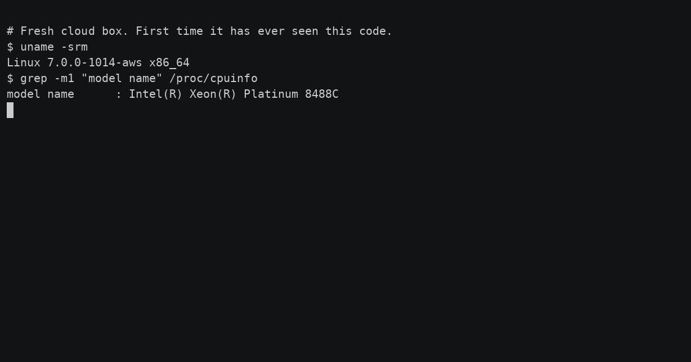

# vitni-tensor

[](https://crates.io/crates/vitni-tensor)
[](https://github.com/vitnify/vitni-tensor/actions/workflows/ci.yml)
[](LICENSE)

**Deterministic, `no_std` tensor engine for verifiable LLM inference.** The same
inputs produce the **same output bits on different CPUs**, across vendors and
instruction sets, by fixing reduction order in floating point and doing k-quant
matmuls in exact integers. It runs stock GGUF models and emits a `vitnify-receipt v2`
model-computation digest that binds the numerical regime (`vitni-regime-2`) for every run.
The same digest is reproduced **across GPU vendors too** — separate host backends
([`cuda/`](cuda) for NVIDIA, Metal for Apple) run the full forward on the GPU and emit a
byte-identical certificate. See [docs/regimes.md](docs/regimes.md) for the two numeric regimes.

vitni-tensor is the deterministic engine under [vitnify](https://vitnify.com),
the execution-receipt layer for AI agents.



## Reproduce the anchor yourself

The determinism claim is checkable, not asserted. Clone the repo, point it at the same
TinyLlama checkpoint CI uses, and re-derive the published anchor on whatever CPU you have:

```sh
git clone https://github.com/vitnify/vitni-tensor
cd vitni-tensor
mkdir -p ci-models
curl -fL -o ci-models/tinyllama-1.1b-Q4_K_M.gguf \
  https://huggingface.co/TheBloke/TinyLlama-1.1B-Chat-v1.0-GGUF/resolve/main/tinyllama-1.1b-chat-v1.0.Q4_K_M.gguf
VITNI_GGUF_TINYLLAMA=ci-models/tinyllama-1.1b-Q4_K_M.gguf ./tools/check-anchors.sh
```

You get the same digest on your machine as the one published in `regime-manifest.json`,
or determinism is broken and you will know immediately.

## Why

Floating-point inference is non-deterministic across hardware (parallel reductions,
FMA fusion, vendor `libm`). vitni-tensor removes every source of divergence on the CPU
path, so a run can be **reproduced bit-for-bit** by an independent party and certified.

## What's inside

- `no_std` core; the only dependencies are a math library and a hash function.
- GGUF loader; grouped-query attention; interleaved (Llama) and NeoX (Qwen2) RoPE;
  optional attention biases; RMSNorm; SwiGLU; KV cache.
- Quantized matmul kernels: **F32 · Q4_0 · Q4_K · Q5_0 · Q6_K · Q8_0**.
- Pinned-order fp32 dot + exact-integer k-quant dots; deterministic `libm` transcendentals.
- A per-run **`vitnify-receipt v2`** model-computation digest (BLAKE3), binding the numerical regime.
- **GPU backends** (separate host crates that reproduce the CPU's digest bit-for-bit): Apple
  Metal and NVIDIA CUDA ([`cuda/`](cuda), sm_75+). Two numeric regimes — `vitni-regime-2`
  (shipped, anchored, float activations) and `regime-3` (reserved, int8 activations for
  deterministic integer-tensor-core throughput). Both deterministic; see
  [docs/regimes.md](docs/regimes.md).

## The receipt binary

```
cargo build --release --bin vitni-receipt
./target/release/vitni-receipt --gguf model.gguf --prompt "1,2,3" --n 20 --model-id my-model
# -> {"model_digest":"…","weights_hash":"…","tokens":[…]}
```

The vitnify SDK calls this to bind the model's computation into a signed execution receipt.

## Tests

`cargo test` runs the unit and determinism tests. The model-driven integration tests
are `#[ignore]`d (they need a GGUF that isn't in the repo); run them with a model:

```
VITNI_GGUF=model.gguf cargo test --release --test tinyllama_gguf -- --ignored --nocapture
```

## Determinism, measured

Across TinyLlama-1.1B, Mistral-7B, and Qwen2.5 on Apple, Arm/AWS Graviton, Intel, and
AMD (two ISAs, two compiler builds), the same run produces a byte-identical certificate
digest. The NVIDIA CUDA and Apple Metal backends reproduce that **same** digest on-GPU
(regime-2), extending the claim across vendors and CPU↔GPU. Details in the paper,
*Reconstructable Execution Certificates for Tool-Using AI Agents*.

## Cite

If you use vitni-tensor or reference the method, cite the paper:

> J. N. Pijeau, "Reconstructable Execution Certificates for Tool-Using AI Agents," preprint, 2026. https://vitnify.com/Vitnify-Paper.pdf

A machine-readable [`CITATION.cff`](CITATION.cff) is in the repo, so GitHub shows a "Cite this repository" button with ready-made BibTeX.

## License

Apache-2.0. **"vitnify"** and **"vitnify-verified"** are trademarks — see
[TRADEMARKS.md](TRADEMARKS.md). A fork may use the code, not the name.

## Part of Vitnify

vitni-tensor is the deterministic engine in a three-repo stack:

- **[vitnify](https://github.com/vitnify/vitnify)** — the Python SDK: capability
  containment, deterministic replay, and signed execution receipts that embed this
  engine's digest.
- **[vitnify-receipt-spec](https://github.com/vitnify/vitnify-receipt-spec)** — the
  canonical `vitnify-receipt v2` format, including the conformance anchor this engine's
  digest reproduces.
- **[vitnify.com](https://vitnify.com)** — the project.
